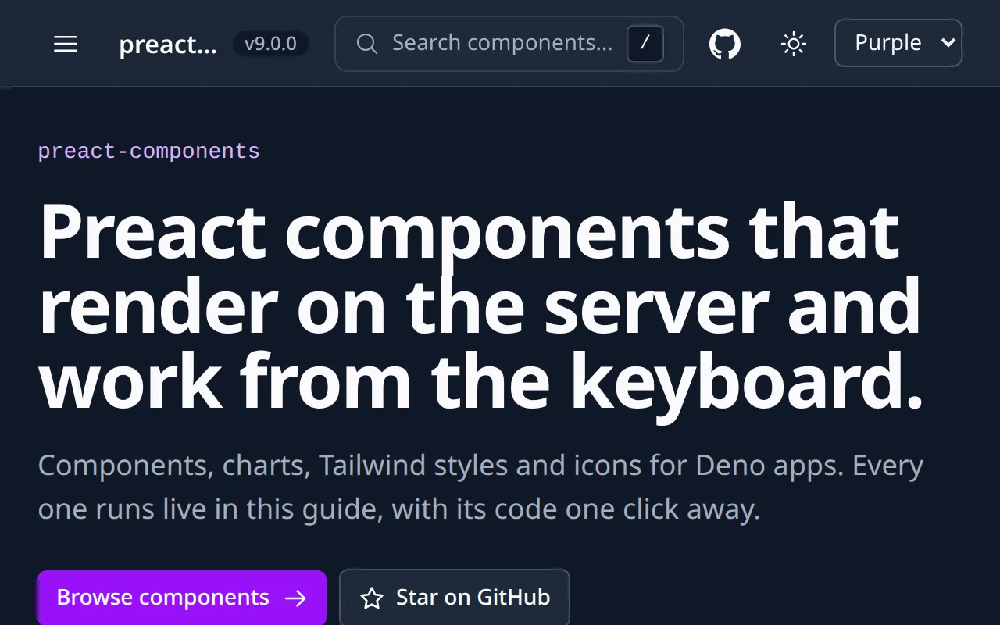

<div align="center">

# preact-components

**Server-rendered Preact and Tailwind components, with a live guide that runs every one.**

[](https://ci.antonshubin.com/repos/9)
[](https://jsr.io/@spy4x/preact-ui)
[](LICENSE)

**Status: beta.** Breaking changes still ship often (1.0.0 to 3.0.0 took three days), and each
one bumps the major version. No screen reader has been run against the components yet
([#210](https://github.com/spy4x/preact-components/issues/210)).

```bash
deno add jsr:@spy4x/preact-ui
```

[**Live guide →**](https://spy4x.github.io/preact-components) ·
[Install and use](docs/usage.md) ·
[llms.txt](llms.txt) for language models · [Credits](CREDITS.md)

The design system and the original markup are by [Eirene](https://github.com/Eirene)
([isorokina.com](https://isorokina.com/)) — see [Credits](#credits).

<a href="https://antonshubin.com/tools/preact-components"></a>

</div>

You install one package, import a component, and it renders with the shared design tokens: the same
button, table, chart and CRUD scaffold in every app, written once. The
[live guide](https://spy4x.github.io/preact-components) runs every component with its code next to
it, so you can try one before you install it.

The components were extracted from real products, so the same pieces are not rebuilt for the next
one. Every package is published on JSR under `@spy4x/preact-*`, all at one version.

<picture>
  <source media="(prefers-color-scheme: dark)" srcset="docs/screenshots/guide-mini-app-dark.png">
  
</picture>

## Where it runs

Every package is a standard ES module built on web standards, with no Deno-only API in anything
published: a component renders to HTML on a server and hydrates in the browser, where it uses the
browser's own APIs, such as the History API, `localStorage`, `IntersectionObserver` and
`ResizeObserver`. The packages are published on JSR, so a Deno app installs them with `deno add`,
and an app that builds with Vite uses them through `@deno/vite-plugin`, with the theme's Vite
plugins ([`theme/README.md`](theme/README.md)). The tests and the build run under Deno 2; running
the packages under Node or Bun has not been tried. [docs/usage.md](docs/usage.md#where-it-runs)
has the details.

## Why preact-components

- **Accessibility written by hand.** Roles, labels, keyboard handling and focus are owned here, and
  browser checks in `pages/checks/` prove the behaviours each package's README names.
- **No component-library dependency.** No Radix, shadcn, Headless UI or Material underneath, and
  no vendored copies of them: [the policy](docs/no-third-party-components.md).
- **Tokens you can override.** Colours, radii and fonts are CSS custom properties read through
  `var()`, so an app restyles everything by setting variables instead of forking CSS.
- **Server-renderable.** Components touch `window` or `document` only in effects and event
  handlers, so they render to HTML on a server and hydrate in the browser.
- **Web standards.** Standard ES modules and the browser's own APIs; nothing a package publishes
  calls a Deno-only API, data arrives through props, and every request goes to an address the app
  supplies.
- **One spacing scale.** Layout goes through `Page`, `Section`, `Stack`, `Cluster` and `Grid`, and
  no component carries an outer margin: [spacing](docs/spacing.md).

**Use it if** you build Preact apps styled with Tailwind and want components whose markup you can
read and change. **Skip it if** you use React.

## Quick start

```bash
deno add jsr:@spy4x/preact-ui
```

```tsx
import { Badge } from "@spy4x/preact-ui/badge"

<Badge text="Active" color="green" />
```

The components render against the compiled Tailwind stylesheet from `@spy4x/preact-theme`; JSR
cannot export a CSS file, so [`theme/README.md`](theme/README.md) has the short build-script recipe.
Every install line, the dependencies between packages and the UI guide as a component are in
[docs/usage.md](docs/usage.md).

## Packages

| Package                                        | What it holds                                                     |
| ---------------------------------------------- | ----------------------------------------------------------------- |
| [`@spy4x/preact-ui`](ui/README.md)             | the component set: layout, buttons, tables, dialogs, forms        |
| [`@spy4x/preact-theme`](theme/README.md)       | design tokens, the Tailwind preset and the classes components use |
| [`@spy4x/preact-icons`](icons/README.md)       | the merged icon set, one component per glyph                      |
| [`@spy4x/preact-charts`](charts/README.md)     | server-rendered charts with tooltips                              |
| [`@spy4x/preact-system`](system/README.md)     | app-level pieces: auth form, calendar, shells, SEO head           |
| [`@spy4x/preact-crud`](crud/README.md)         | list and editor scaffold for one collection                       |
| [`@spy4x/preact-map`](map/README.md)           | map on Leaflet                                                    |
| [`@spy4x/preact-signals`](signals/README.md)   | stores and state helpers; no components                           |
| [`@spy4x/preact-cn`](cn/README.md)             | class-name join with Tailwind conflict resolution                 |
| [`@spy4x/preact-ui-guide`](ui-guide/README.md) | the live component catalogue, mounted in one line                 |
| [`pages/`](pages/README.md)                    | the demo site and browser checks; not published                   |

## Development

```bash
deno task check              # format, lint, type check and tests
deno task --cwd pages build  # build the demo site the live guide serves
```

Rules for changing the repository: [docs/maintaining.md](docs/maintaining.md) and
[`AGENTS.md`](AGENTS.md).

## Credits

The design system, the component styling and the original markup in this repository come from
Eirene — https://github.com/Eirene, https://isorokina.com/. This repository turned that work into a
reusable Preact + signals package. See [`CREDITS.md`](./CREDITS.md).

## Built by

I'm [Anton Shubin](https://antonshubin.com), a senior full-stack engineer and tech lead.
preact-components is the UI I extracted from earlier applications, and `spy4x/seed`, which new
projects start from, builds on it. Need
something like it built for your product? [That's my day job →](https://antonshubin.com)

Licensed under [MIT](LICENSE). Copyright (c) 2026 Anton Shubin.

---

Made by Anton Shubin · [antonshubin.com/tools](https://antonshubin.com/tools/preact-components)
